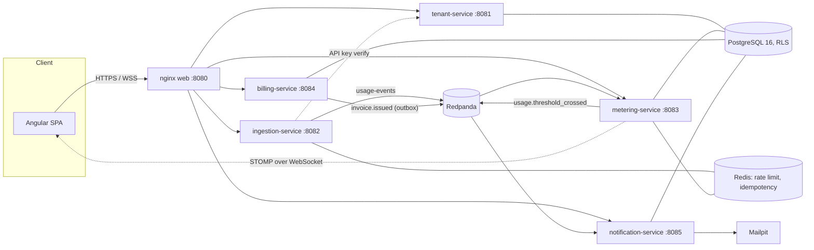

# Meterly

Meterly is a multi-tenant SaaS billing & usage-metering platform: tenants ingest metered usage events
(API calls, webhook deliveries, anything countable), watch a live dashboard update in real time, and
get a cent-accurate tiered invoice at the end of each month. It exists as a portfolio-scale
demonstration of the hard parts of that problem done properly: PostgreSQL Row-Level Security for
tenant isolation, exactly-once counting under client retries and Kafka redelivery, `BigDecimal`
billing math with a single documented rounding rule, and a black-box harness that proves all of it
against a live stack rather than asserting it in prose.

**Why Java** for the backend, tooling and the exit-criteria harness (not just "because Spring Boot"):
see [`docs/why-java.md`](docs/why-java.md). The only non-Java code is the Angular SPA and
infrastructure configuration.

## Architecture



End-to-end flow, RLS design, idempotency at every hop and what's explicitly deferred are in
[`docs/architecture.md`](docs/architecture.md).

## Services

| Service | Port | Responsibility |
|---|---|---|
| `tenant-service` | 8081 | Tenants, users, JWT issuance + JWKS, plans, subscriptions, resources, API keys |
| `ingestion-service` | 8082 | Usage-event intake: API-key/JWT auth, per-tenant rate limiting, idempotency, Kafka publish |
| `metering-service` | 8083 | Idempotent usage ledger, Redis counters, live STOMP dashboard updates, reconciliation |
| `billing-service` | 8084 | Period-close billing, tiered `BigDecimal` pricing, idempotent invoices, outbox relay |
| `notification-service` | 8085 | Invoice/threshold email notifications (pluggable provider; logging or SMTP/Mailpit) |
| `meterly-web` | 8080 | Angular SPA behind nginx, reverse-proxies `/v1/**` and `/ws/usage` to the services above |
| `meterly-db` (migrator) | — | One-shot Flyway migration Job/container; the only role that ever runs DDL |
| `meterly-validation` | — | Black-box exit-criteria harness + load generator (this doc, §"Validation harness") |

Infrastructure: PostgreSQL 16 (RLS), Redis 7 (cache + rate limiter + pub/sub), Redpanda (Kafka-API
compatible; see [`docs/architecture.md`](docs/architecture.md) for why), Mailpit (SMTP sink for local
email).

## Quickstart

Requires Docker Desktop and a JDK 21+ (nothing else: the bootstrap is plain Java).

```bash
java scripts/Bootstrap.java       # generates .env + secrets/jwt-{private,public}.pem (gitignored, once)
docker compose up -d --build      # postgres, redis, redpanda, migrator, all 5 services, web, mailpit
```

(`pwsh scripts/bootstrap.ps1` does the same on PowerShell 7+.)

Wait for everything healthy (`docker compose ps`), then:

| What | URL |
|---|---|
| App | http://localhost:8080 |
| Mailpit (dev email) | http://localhost:8025 |
| PostgreSQL | `localhost:55432` (db `meterly`) |
| Redis | `localhost:16379` |
| Kafka API (Redpanda) | `localhost:19092` |

### Demo credentials

The migrator seeds two demo tenants (`db/demo/R__demo_seed.sql`, only applied when
`MIGRATION_LOCATIONS` includes `classpath:db/demo` — the Compose default; see
[`docs/operations.md`](docs/operations.md) for disabling it in a real deployment):

| Tenant | Login | Password | Plan | API key |
|---|---|---|---|---|
| Acme Corp | `admin@acme.test` | `Meterly!2026` | STARTER | `mk_live_6Nfuu8kyqiwSqUtZKiUCFxXR_qss52QDotFDIX_3EDY` |
| Acme Corp | `viewer@acme.test` (TENANT_USER) | `Meterly!2026` | — | — |
| Globex | `admin@globex.test` | `Meterly!2026` | GROWTH | `mk_live_PD2LNw8f1F2RxuhbmnBm-hnoC0WQGifEW5BUKXVu4kA` |

Acme's previous-month usage bills to **278.69 USD**; Globex's to **249.00 USD** (hand-calculated in
the seed file's comments — this is also what `meterly-validation` independently recomputes).

### curl examples

```bash
# Log in
curl -s -X POST http://localhost:8080/v1/auth/login \
  -H 'Content-Type: application/json' \
  -d '{"email":"admin@acme.test","password":"Meterly!2026"}'

# Send a usage event with the demo API key
curl -s -X POST http://localhost:8080/v1/usage-events \
  -H 'X-API-Key: mk_live_6Nfuu8kyqiwSqUtZKiUCFxXR_qss52QDotFDIX_3EDY' -H 'Content-Type: application/json' \
  -d '{"resource_id":"a1111111-0000-4000-8000-000000000001","idempotency_key":"demo-1","quantity":1}'

# Current-period usage (needs a bearer token from /v1/auth/login)
curl -s http://localhost:8080/v1/usage/current -H "Authorization: Bearer $TOKEN"
```

Full request/response shapes, error codes and the Kafka/Redis contract are in
[`docs/api-contract.md`](docs/api-contract.md).

## Tests

```bash
./mvnw -B -ntp verify                      # every backend module: unit + ArchUnit + Testcontainers ITs
cd meterly-web && npm ci && npm test       # Angular unit tests (headless Chrome in CI)
```

CI (`.github/workflows/ci.yml`) runs both plus a matrix Docker image build (all 6 backend targets +
web) and a secret scan on every push/PR. Dependabot (`.github/dependabot.yml`) keeps Maven, npm,
Docker base images and GitHub Actions current, weekly.

## Validation harness

`meterly-validation` is a plain-Java black-box harness (no Testcontainers, no mocks) that proves the
release bar in [`docs/api-contract.md` §9](docs/api-contract.md#9-validation-bar-release-evidence)
against a **running** Compose stack: three tenants + PostgreSQL RLS, 950 idempotent usage events under
client retries and Kafka redelivery, independently recomputed cent-accurate billing, per-tenant rate
limits, and STOMP dashboard latency (p50/p95/p99, pass iff p95 < 850ms and ≥ 18/20 of the first 20
trials land within 2s).

```bash
export DB_APP_PASSWORD=<the value bootstrap.ps1 generated into .env>
java -jar meterly-validation/target/meterly-validation.jar \
  --base-url http://localhost:8080 \
  --jdbc-url jdbc:postgresql://localhost:55432/meterly \
  --kafka localhost:19092 \
  --report validation-output/validation-report.md

# Standalone soak test (not part of the pass/fail bar):
java -jar meterly-validation/target/meterly-validation.jar load \
  --api-key mk_live_6Nfuu8kyqiwSqUtZKiUCFxXR_qss52QDotFDIX_3EDY \
  --resource-id a1111111-0000-4000-8000-000000000001 --rps 20 --duration 60
```

Exits non-zero on any failed check. `validation-output/` is gitignored.

## Observability

```bash
docker compose --profile observability up -d prometheus grafana postgres-exporter
```

Grafana at http://localhost:3000 (default `admin`/`admin`, override with `GRAFANA_ADMIN_PASSWORD`),
pre-provisioned with a Prometheus datasource and two dashboards (**Meterly - Services**: HTTP
rate/p95 latency/status per service, JVM heap/threads; **Meterly - Usage & Billing Pipeline**:
ingestion outcomes and rate limiting, metering inserted-vs-duplicate, billing runs by outcome, outbox
published/backlog, reconciliation drift, notification dead-letters). Prometheus itself at
http://localhost:9090. See [`docs/operations.md`](docs/operations.md) for metric names and what each
panel means.

## Kubernetes (stretch)

```bash
kubectl kustomize deploy/k8s/overlays/local   # render; `kubectl apply -k ...` against a real cluster
```

`deploy/k8s/base` has a Deployment/Service/ConfigMap per service, a migrator Job, HPAs for
`ingestion-service`/`metering-service`, PodDisruptionBudgets, and an Ingress for the SPA.
PostgreSQL/Redis/Kafka are treated as externally managed infrastructure, not deployed here — see
`deploy/k8s/base/configmap-shared.yaml` and [`docs/operations.md`](docs/operations.md).

## Project layout

```
tenant-service/ ingestion-service/ metering-service/     Spring Boot 3.5 / Java 21 microservices
billing-service/ notification-service/
meterly-common/          shared library: JSON conventions, RLS/tenant context, security, events
meterly-db/              Flyway migrations (owned per-service version ranges, see api-contract.md §8)
                          + the one-shot migrator app + demo seed data
meterly-test-support/    Testcontainers helpers shared by every service's integration tests
meterly-validation/      the exit-criteria harness and load generator (this doc, §"Validation harness")
meterly-web/             Angular 18 SPA
deploy/                  nginx SPA config, Postgres role bootstrap, Redpanda topic bootstrap,
                          deploy/k8s (Kubernetes), deploy/observability (Prometheus/Grafana)
docs/                    api-contract.md (binding), architecture.md, operations.md, engineering-guide.md,
                          why-java.md, the original PDD/POC
scripts/Bootstrap.java   generates local-only secrets (.env, secrets/*.pem); never commits them
                          (scripts/bootstrap.ps1 is the PowerShell 7 equivalent)
.github/                 CI workflow + Dependabot
```

## Explicitly out of scope

Multi-currency, tax, dunning, proration, payment collection, and Keycloak/OIDC federation are
deliberate, documented gaps — see [`docs/architecture.md`](docs/architecture.md#deferred-scope).
