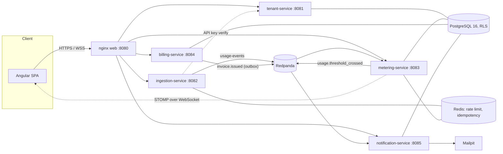

# Meterly

Meterly is a multi-tenant SaaS billing and usage-metering platform. Tenants send metered usage events (API calls, webhook deliveries, anything countable), watch a live dashboard update in real time, and get a cent-accurate tiered invoice at the end of each month.

I built it as a portfolio project to work through the hard parts of usage billing and do them properly:

- PostgreSQL Row-Level Security (RLS) for tenant isolation
- exactly-once counting under client retries and Kafka redelivery
- `BigDecimal` billing math with a single documented rounding rule
- a black-box harness that proves all of this against a live stack, instead of just claiming it in the docs

I wrote the backend, the tooling and the validation harness in Java. I explain why (it was not just "because Spring Boot") in [`docs/why-java.md`](docs/why-java.md). The only non-Java code is the Angular SPA and the infrastructure configuration.

## Architecture



The end-to-end flow, the RLS design, idempotency at every hop, and what I deferred on purpose are written up in [`docs/architecture.md`](docs/architecture.md).

### Services

| Service | Port | What it does |
|---|---|---|
| `tenant-service` | 8081 | Tenants, users, JWT issuance and JWKS, plans, subscriptions, resources, API keys |
| `ingestion-service` | 8082 | Usage-event intake: API-key/JWT auth, per-tenant rate limiting, idempotency, Kafka publish |
| `metering-service` | 8083 | Idempotent usage ledger, Redis counters, live STOMP dashboard updates, reconciliation |
| `billing-service` | 8084 | Period-close billing, tiered `BigDecimal` pricing, idempotent invoices, outbox relay |
| `notification-service` | 8085 | Invoice and threshold email notifications (pluggable provider: logging or SMTP/Mailpit) |
| `meterly-web` | 8080 | Angular SPA behind nginx, reverse-proxies `/v1/**` and `/ws/usage` to the services above |
| `meterly-db` (migrator) | n/a | One-shot Flyway migration Job/container. It is the only role that ever runs DDL |
| `meterly-validation` | n/a | Black-box validation harness and load generator (see "Validation harness" below) |

Infrastructure: PostgreSQL 16 (RLS), Redis 7 (cache, rate limiter, pub/sub), Redpanda (Kafka-API compatible; I explain the choice in [`docs/architecture.md`](docs/architecture.md)), and Mailpit (SMTP sink for local email).

## Key results

The validation harness checks the release bar against a running Compose stack:

- three tenants isolated by PostgreSQL RLS
- 950 idempotent usage events under client retries and Kafka redelivery
- billing recomputed independently and matched to the cent
- per-tenant rate limits
- STOMP dashboard latency (p50/p95/p99). It passes only if p95 < 850ms and at least 18 of the first 20 trials land within 2s

With the demo seed, Acme's previous-month usage bills to **278.69 USD** and Globex's to **249.00 USD**. I calculated these by hand in the seed file's comments, and `meterly-validation` recomputes them on its own.

## How to run it

You need Docker Desktop and JDK 21+. Nothing else, since the bootstrap is plain Java.

```bash
java scripts/Bootstrap.java       # generates .env + secrets/jwt-{private,public}.pem (gitignored, once)
docker compose up -d --build      # postgres, redis, redpanda, migrator, all 5 services, web, mailpit
```

On PowerShell 7+, `pwsh scripts/bootstrap.ps1` does the same thing.

Wait until everything is healthy (`docker compose ps`), then open:

| What | URL |
|---|---|
| App | http://localhost:8080 |
| Mailpit (dev email) | http://localhost:8025 |
| PostgreSQL | `localhost:55432` (db `meterly`) |
| Redis | `localhost:16379` |
| Kafka API (Redpanda) | `localhost:19092` |

### Demo credentials

The migrator seeds two demo tenants from `db/demo/R__demo_seed.sql`. This seed is only applied when `MIGRATION_LOCATIONS` includes `classpath:db/demo`, which is the Compose default. [`docs/operations.md`](docs/operations.md) shows how to turn it off for a real deployment.

Demo passwords and API keys are generated locally. See `scripts/bootstrap.ps1` and the demo seed (`meterly-db/src/main/resources/db/demo/R__demo_seed.sql`).

| Tenant | Login | Password | Plan | API key |
|---|---|---|---|---|
| Acme Corp | `admin@acme.test` | `<demo-password>` | STARTER | `<your-api-key>` |
| Acme Corp | `viewer@acme.test` (TENANT_USER) | `<demo-password>` | n/a | n/a |
| Globex | `admin@globex.test` | `<demo-password>` | GROWTH | `<your-api-key>` |

### curl examples

```bash
# Log in
curl -s -X POST http://localhost:8080/v1/auth/login \
  -H 'Content-Type: application/json' \
  -d '{"email":"admin@acme.test","password":"<demo-password>"}'

# Send a usage event with the demo API key
curl -s -X POST http://localhost:8080/v1/usage-events \
  -H 'X-API-Key: <your-api-key>' -H 'Content-Type: application/json' \
  -d '{"resource_id":"a1111111-0000-4000-8000-000000000001","idempotency_key":"demo-1","quantity":1}'

# Current-period usage (needs a bearer token from /v1/auth/login)
curl -s http://localhost:8080/v1/usage/current -H "Authorization: Bearer $TOKEN"
```

Full request and response shapes, error codes, and the Kafka/Redis contract are in [`docs/api-contract.md`](docs/api-contract.md).

### Tests

```bash
./mvnw -B -ntp verify                      # every backend module: unit + ArchUnit + Testcontainers ITs
cd meterly-web && npm ci && npm test       # Angular unit tests (headless Chrome in CI)
```

CI (`.github/workflows/ci.yml`) runs both, plus a matrix Docker image build (all 6 backend targets and the web app) and a secret scan on every push and PR. Dependabot (`.github/dependabot.yml`) keeps Maven, npm, Docker base images and GitHub Actions up to date every week.

### Validation harness

`meterly-validation` is a plain-Java black-box harness (no Testcontainers, no mocks). It proves the release bar in [`docs/api-contract.md` section 9](docs/api-contract.md#9-validation-bar-release-evidence) against a **running** Compose stack.

```bash
export DB_APP_PASSWORD=<the value bootstrap.ps1 generated into .env>
java -jar meterly-validation/target/meterly-validation.jar \
  --base-url http://localhost:8080 \
  --jdbc-url jdbc:postgresql://localhost:55432/meterly \
  --kafka localhost:19092 \
  --report validation-output/validation-report.md

# Standalone soak test (not part of the pass/fail bar):
java -jar meterly-validation/target/meterly-validation.jar load \
  --api-key <your-api-key> \
  --resource-id a1111111-0000-4000-8000-000000000001 --rps 20 --duration 60
```

It exits non-zero if any check fails. `validation-output/` is gitignored.

### Observability

```bash
docker compose --profile observability up -d prometheus grafana postgres-exporter
```

Grafana runs at http://localhost:3000 (default `admin`/`admin`, override with `GRAFANA_ADMIN_PASSWORD`). It comes with a Prometheus datasource and two dashboards:

- **Meterly - Services**: HTTP rate, p95 latency and status per service, JVM heap and threads
- **Meterly - Usage & Billing Pipeline**: ingestion outcomes and rate limiting, metering inserted vs. duplicate, billing runs by outcome, outbox published and backlog, reconciliation drift, notification dead-letters

Prometheus itself runs at http://localhost:9090. [`docs/operations.md`](docs/operations.md) lists the metric names and what each panel means.

### Kubernetes (stretch goal)

```bash
kubectl kustomize deploy/k8s/overlays/local   # render; `kubectl apply -k ...` against a real cluster
```

`deploy/k8s/base` has a Deployment, Service and ConfigMap per service, a migrator Job, HPAs for `ingestion-service` and `metering-service`, PodDisruptionBudgets, and an Ingress for the SPA. I treat PostgreSQL, Redis and Kafka as externally managed infrastructure, so they are not deployed here. See `deploy/k8s/base/configmap-shared.yaml` and [`docs/operations.md`](docs/operations.md).

## Project structure

```
tenant-service/ ingestion-service/ metering-service/     Spring Boot 3.5 / Java 21 microservices
billing-service/ notification-service/
meterly-common/          shared library: JSON conventions, RLS/tenant context, security, events
meterly-db/              Flyway migrations (owned per-service version ranges, see api-contract.md section 8)
                          + the one-shot migrator app + demo seed data
meterly-test-support/    Testcontainers helpers shared by every service's integration tests
meterly-validation/      the validation harness and load generator (see "Validation harness")
meterly-web/             Angular 18 SPA
deploy/                  nginx SPA config, Postgres role bootstrap, Redpanda topic bootstrap,
                          deploy/k8s (Kubernetes), deploy/observability (Prometheus/Grafana)
docs/                    api-contract.md (binding), architecture.md, operations.md, engineering-guide.md,
                          why-java.md, the original PDD/POC
scripts/Bootstrap.java   generates local-only secrets (.env, secrets/*.pem); never commits them
                          (scripts/bootstrap.ps1 is the PowerShell 7 equivalent)
.github/                 CI workflow + Dependabot
```

## What I learned

- Counting exactly once is a whole-pipeline problem. Client retries and Kafka redelivery both create duplicates, so I made every hop idempotent (Redis at ingestion, an idempotent ledger in metering, idempotent invoices and an outbox in billing).
- Tenant isolation is safer in the database than in application code. PostgreSQL RLS enforces it, and only the migrator role is allowed to run DDL.
- Money math needs one rule. I use `BigDecimal` with a single documented rounding rule, and I hand-calculated the seed invoices so the harness has a known answer to check against.
- Tests that mock everything can still pass on a broken system. That is why I wrote a black-box harness that runs against the real stack and fails loudly.

## Out of scope

Multi-currency, tax, dunning, proration, payment collection, and Keycloak/OIDC federation are gaps I left on purpose and documented. See [`docs/architecture.md`](docs/architecture.md#deferred-scope).
